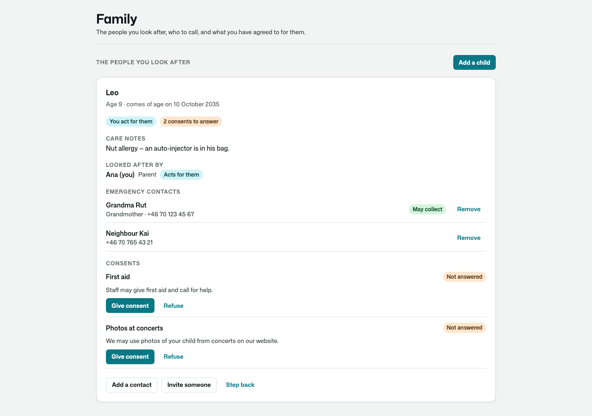
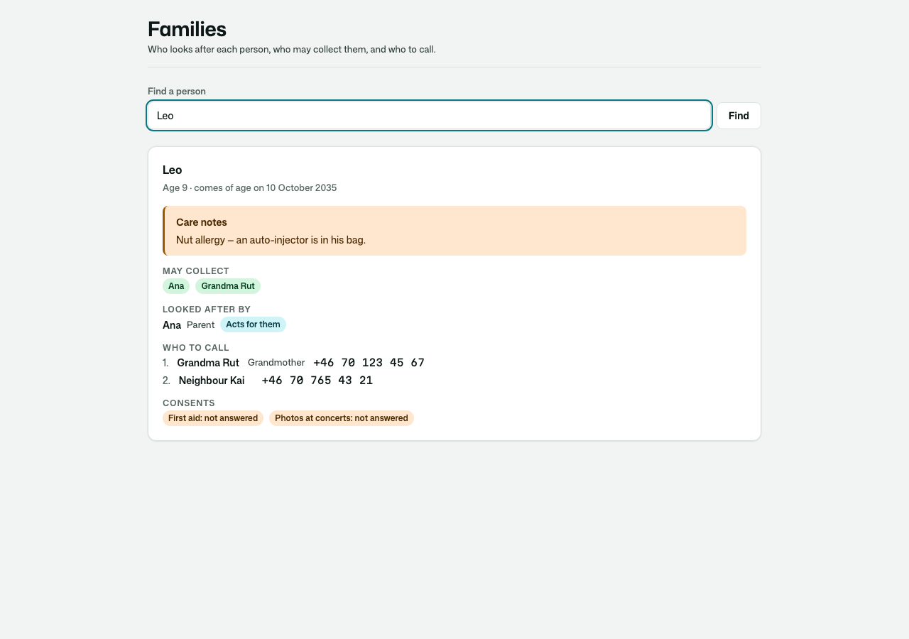
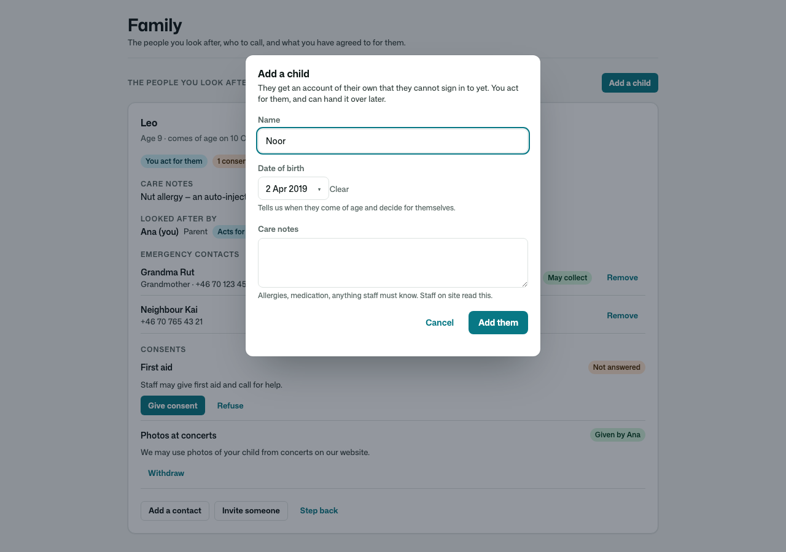
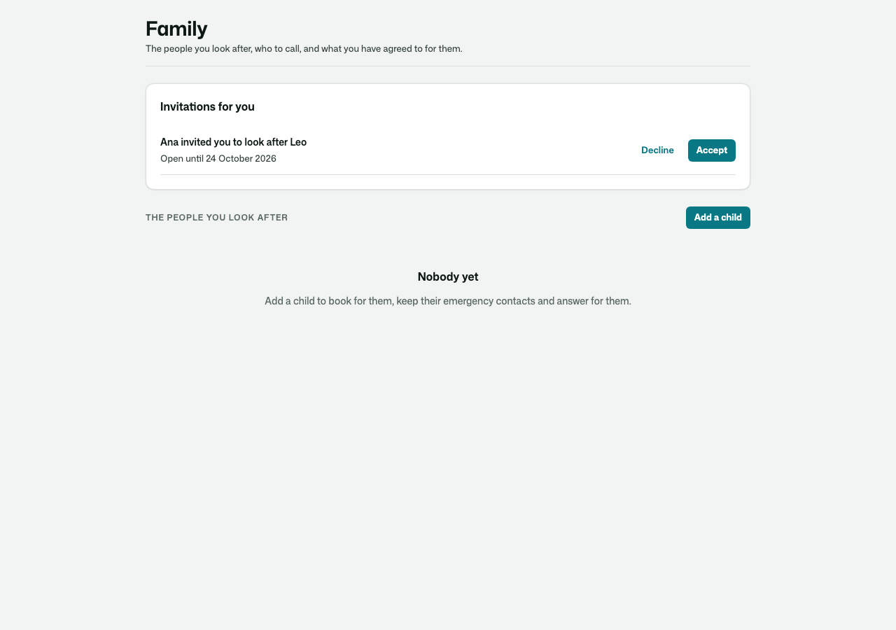
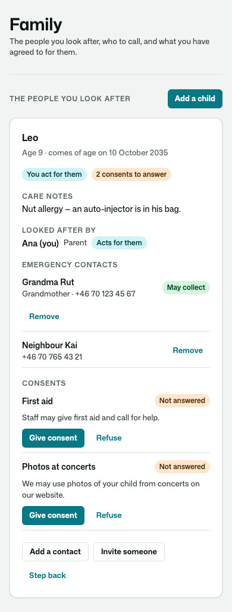
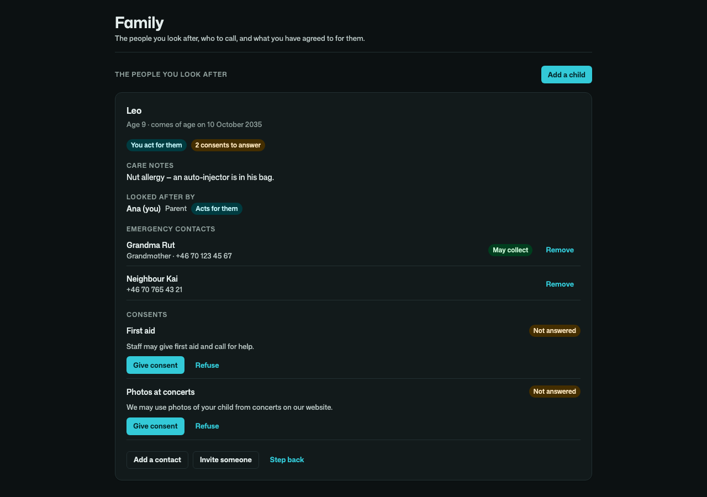

# Osysharp.Guardianship

**Who acts for whom** — the adults who look after a child (or anyone who needs someone to act for them), what each of
them may do, and what they have agreed to on the child's behalf.

For a swim school, a music school, a sports club, a holiday camp, a tutoring service, a nursery — any app where a parent
books, signs and answers for someone else.

- **Add a child** — an account of their own that they cannot sign in to yet (Osysharp.UserAccounts' managed accounts), with
  their date of birth and the care notes staff must know. Hand it over later, and they sign in themselves.
- **Several guardians** — invite a second parent, a grandparent or a carer by address; they accept once signed in with that
  address. Each link **acts for them**, keeps the guardian **informed**, or has **ended** — and nobody makes themself
  somebody's guardian.
- **Coming of age** — on the birthday the app names (18, or 16, or whatever it says), every acting guardian's standing
  changes by itself, on a durable clock: ended, or narrowed to being kept informed. From then on the person decides.
- **Consents** — the app's questions (photos, first aid, travel) answered by a guardian for a minor and by an adult for
  themself, each answer kept with the exact words it answered; new words ask everyone again.
- **Emergency contacts and collection** — who to call, in order, and who may collect the child; read by staff on site
  with the care notes.
- **One policy for your own rules** — `ActsForDependant(person)` (and `KeptInformedOf(person)` for read-only).

|  |  |
|---|---|
|  |  |
|  |  |

## Use it

```osy
// app.osy
use Osysharp.Identity@0;
use Osysharp.UserAccounts@1;
use Osysharp.Guardianship@0;
```

```osy
using Osysharp.Identity;
using Osysharp.Guardianship;

policy ManagesGuardianships => IsOffice;             // corrects any link, manages the consent forms
policy SeesFamilies => IsOffice || IsTeacher;         // reads links, contacts and care notes on site
policy MakesManagedAccounts => IsAuthenticated;       // Osysharp.UserAccounts: any member may add a child

app.Guardianship = new GuardianshipSetup { AgeOfMajority = 16, AtMajority = GuardianStanding.Informed };

// Your own rule, built on the kit's policy: a parent reads their child's lesson notes.
entity LessonNote {
  [Required] Principal Pupil;
  [Required, MaxLength(400)] string Text;
  security {
    allow read when IsAuthenticated where Pupil == user;
    allow read when LooksAfterSomeone where KeptInformedOf(Pupil);
  }
}
```

The pages are served at `/family` (a parent's, a guardian's, and an adult's own "who looks after me") and
`/family/lookup` (for `SeesFamilies`). Take one over by declaring a component of the same name; place `FamilyScreen()`,
`FamilyLookup()` or `FamilyCard(…)` on pages of your own. Every colour and size comes from the theme, so a look re-skins
them.

From code: `AddDependant(name, bornOn)`, `InviteGuardian(child, address)`, `AcceptGuardianInvitation(i)`,
`ChangeStanding(link, GuardianStanding.Informed, reason)`, `LinkGuardian(guardian, child)` (the desk),
`SetBornOn(profile, date)`, `DeclareOfAge(profile)`, `HandOverAccount(child, address)`,
`AnswerConsent(child, form, ConsentAnswer.Given)`, `HasConsent(child, "photos")`, `ReviseConsentForm(form, words)`,
`EmergencyContactsOf(child)`, `MayCollectNames(child)`, `DependantsOf(guardian)`, `MeAndMyDependants()`.
The app hears `GuardianLinked`, `GuardianStandingChanged`, `GuardianInvited`, `ConsentAnswered` and `DependantCameOfAge`.

Booking for a child is one line with Osysharp.ClassBookings:
`policy BooksFor(Principal person) => person == user || ActsForDependant(person);`.

## Personal data

Dates of birth, care notes (special-category data), emergency contacts and invitation addresses are classified, so their
values never reach the audit trail. An app that also uses Osysharp.Privacy gets **Osysharp.Privacy.Guardianship** by
itself, which counts, copies out and erases all of it on request.

## What informed it

Brightwheel's contact types (parent, family member who is kept informed, approved pickup, emergency contact) shaped the
standings and `MayCollect`; childcare and camp enrolment forms (an emergency contact other than the parent, authorised
adults, custody restrictions, medical notes) shaped the contacts and care notes; GDPR Art. 8's parental consent for
children shaped consents answered by a guardian until the child decides; versioned waivers (asking again when the words
change) shaped consent forms.

## Source and tests

`model/` is the kit; `tests/` is a music school that uses it — 53 tests as real people (parents, a teacher, the office, a
stranger, a barred adult), seven of them driving the pages. `osy test` in `tests/`; `--pixels` for the
screenshots above.
